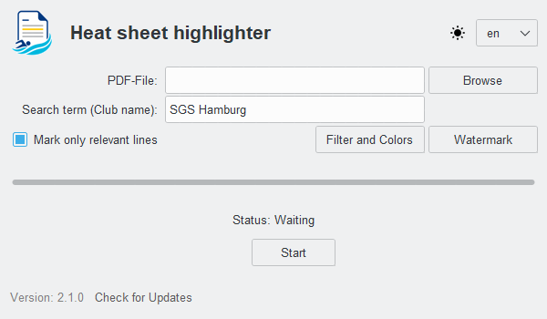
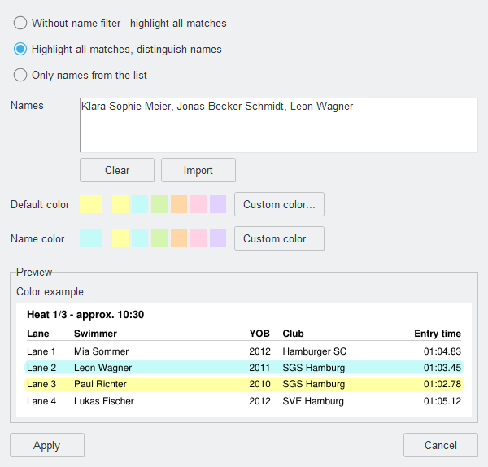
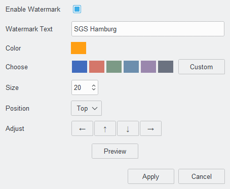

<div align="center">
  

  <h1>Heat Sheet PDF Highlighter</h1>

  <p>Highlight heat-sheet PDFs by club, swimmer name, or custom search term.</p>

  <p>
    <a href="https://github.com/jonalbr/heat-sheet-pdf-highlighter/releases/latest">
      
    </a>
    <a href="https://www.codefactor.io/repository/github/jonalbr/heat-sheet-pdf-highlighter">
      
    </a>
    <a href="LICENSE">
      
    </a>
    <a href="https://www.paypal.me/AlbrechtJonas">
      
    </a>
  </p>

  <p>
    <a href="https://github.com/jonalbr/heat-sheet-pdf-highlighter/releases/latest/download/heat_sheet_pdf_highlighter_installer.exe">
      
    </a>
  </p>
</div>

<p align="center">
  <picture>
    <source media="(prefers-color-scheme: dark)" srcset="images/app_screenshot_dark.png">
    <source media="(prefers-color-scheme: light)" srcset="images/app_screenshot_light.png">
    
  </picture>
</p>

## Install

[Download for Windows](https://github.com/jonalbr/heat-sheet-pdf-highlighter/releases/latest/download/heat_sheet_pdf_highlighter_installer.exe), run the installer, and launch the app from the Start menu.

If SmartScreen blocks the unsigned installer, choose **More info** → **Run anyway**.

Windows only; running from source on macOS or Linux is untested.

## Quick start

1. Click **Browse** and choose a heat-sheet PDF.
2. Enter a club name or other search term.
3. Optionally adjust **Filter and Colors** or add a watermark.
4. Click **Start** and save the highlighted PDF.

For scanned PDFs, choose German or English when prompted for OCR. The app saves a new PDF with a `_highlighted` suffix.

## Features

- Highlight matching rows, distinguish selected swimmers by color, or mark only listed names
- Import names from CSV or text files
- Preview custom highlight colors and position watermarks
- Read scanned PDFs with bundled German and English OCR
- English and German interface, system/light/dark themes, and saved preferences
- In-app updates on Windows

## Screenshots

<details>
<summary>Filter, colors, and watermark dialogs</summary>

Filter and colors dialog:

<div align="center">
  <picture>
    <source media="(prefers-color-scheme: dark)" srcset="images/app_screenshot_filter_dark.png">
    <source media="(prefers-color-scheme: light)" srcset="images/app_screenshot_filter_light.png">
    
  </picture>
</div>

Watermark dialog:

<div align="center">
  <picture>
    <source media="(prefers-color-scheme: dark)" srcset="images/app_screenshot_watermark_dark.png">
    <source media="(prefers-color-scheme: light)" srcset="images/app_screenshot_watermark_light.png">
    
  </picture>
</div>

</details>

## Run from source

To run from source, install [`uv`](https://docs.astral.sh/uv/), then:

```powershell
git clone https://github.com/jonalbr/heat-sheet-pdf-highlighter.git
cd heat-sheet-pdf-highlighter
uv python install
uv sync --locked --all-groups
uv run python main.py
```

For development, translations, builds, and releases, see [CONTRIBUTING.md](CONTRIBUTING.md).

## Support the Project

If the app helps you, you can support its development:

<div align="center">
  <a href="https://ko-fi.com/L4L81ZOT4V">
    
  </a>
</div>

## License

[GNU General Public License v3.0](LICENSE).

Bundled OCR language files use Apache-2.0; see [assets/ocr](assets/ocr).
